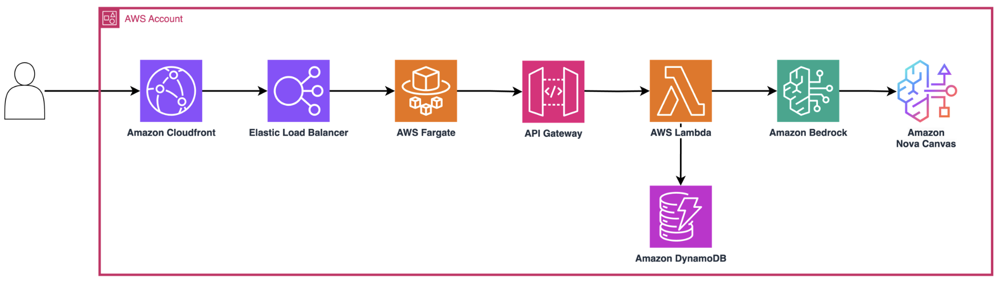

# AWS Sticker Studio

> **⚠️ Important:** This project is sample/demo code intended for educational and demonstration purposes only. It is not intended for production use without additional security review, testing, and hardening appropriate to your workload requirements.

A web app for generating custom AWS-themed stickers. Pick a character, an activity, and a location — the app uses Amazon Bedrock (Stability AI Ultra) to generate a sticker-style illustration, wraps it in a circular badge overlay with curved text, and gives you a downloadable PNG.



## How it works

1. User logs in via Amazon Cognito hosted UI
2. Picks a character (corgi, dragon, fox…), activity (coding, surfing, yoga…), and location
3. The frontend calls Amazon API Gateway → AWS Lambda, which prompts Bedrock (Stability AI Ultra) to generate 3 image variants
4. Lambda composites each image into a circular sticker badge with curved text using Pillow, stores results in Amazon Simple Storage Service (Amazon S3)
5. Presigned URLs are returned to the frontend for preview and download

## Architecture

```
User ──▶ Amazon CloudFront ──▶ Application Load Balancer ──▶ Amazon ECS on AWS Fargate (Next.js)
              │                        │
              │                        ▼
              │                  API Gateway ──▶ Lambda ──▶ Bedrock (Stability AI Ultra)
              │                                   │
              │                                   ▼
              │                          S3 (images + fonts)
              │                          Amazon DynamoDB (request log)
              │
              ├── /_next/static/*   → cached (CACHING_OPTIMIZED)
              └── /_next/image*     → cached (custom policy, query-string aware)
```

### Frontend — Next.js on Amazon Elastic Container Service (Amazon ECS) AWS Fargate

The frontend is a Next.js 15 app running in standalone mode inside ARM64 containers on AWS Fargate (512 CPU / 1 GB, **2 tasks by default**). It handles the UI, Cognito OAuth callback, and server-side token refresh via middleware. Protected routes (`/create`, `/print`) require a valid Cognito ID token stored in an httpOnly cookie; the middleware silently refreshes expired tokens using the refresh token before falling back to a login redirect.

The Application Load Balancer sits in an Amazon Virtual Private Cloud (Amazon VPC) with 2 AZs. Direct access to the Application Load Balancer is blocked — the default listener action returns 403. Only requests carrying a secret `X-Origin-Verify` header (stored in Secrets Manager, injected by CloudFront as a custom origin header) are forwarded to the target group. The Application Load Balancer security group restricts ingress to the CloudFront managed prefix list.

### CDN — CloudFront

CloudFront is the single entry point. It enforces HTTPS redirect, adds security headers (HSTS, X-Content-Type-Options, X-Frame-Options DENY, Referrer-Policy), and provides three cache behaviors:

- Default (`/*`) — no caching, all viewer headers/cookies forwarded to origin (dynamic pages + API proxying)
- `/_next/static/*` — long-lived immutable assets, CACHING_OPTIMIZED policy
- `/_next/image*` — image optimization responses, custom cache policy keyed on `Accept` header + all query strings

In production, a custom domain + ACM certificate can be attached. Price class is set to PRICE_CLASS_100 (North America + Europe).

### API — API Gateway + Lambda

A regional REST API Gateway with a Cognito authorizer protects the `/generateImages` POST endpoint. Request bodies are validated against a JSON schema requiring `character`, `activity`, and `location` strings. CORS origins are environment-specific (localhost for dev, CloudFront domain for staging, custom domain for prod).

The Lambda (Python 3.12, 1 GB memory, 90s timeout) does the following:
1. Validates and sanitizes input (word characters, punctuation, and spaces; max 100 chars)
2. Calls Bedrock (Stability AI Ultra) to generate 3 sticker images (1024×1024)
3. For each image, composites a circular badge overlay with curved text using Pillow (loaded as a Lambda layer from Klayers)
4. Uploads results to S3 under `generated_images/{uuid}/`
5. Returns 3 presigned URLs (1h expiry)

Request metadata (character, activity, location, timestamp) is logged to a DynamoDB table with a 30-day TTL.

### Storage — S3

A single AWS Key Management Service (AWS KMS)-encrypted, versioned S3 bucket stores generated images and font assets (Amazon Ember Bold). Public access is fully blocked. Lifecycle rules cancel incomplete multipart uploads after 7 days and expire old object versions after 30 days. Fonts are deployed to the bucket via CDK's `BucketDeployment`.

### Auth — Cognito

A Cognito User Pool with email sign-in, no self-signup, and strict password policy. The app client uses the authorization code grant with OIDC/email/profile scopes. Callback URLs are dynamically generated based on the environment (localhost for dev, CloudFront domain, custom domain). A post-deploy script updates callback URLs once the CloudFront domain is known.

### CDK Stacks

All infrastructure is defined in 5 CDK stacks with explicit cross-stack dependencies:

| Stack | Layer | Depends On | Key Resources |
|---|---|---|---|
| BucketStack | Foundation | — | S3 bucket, AWS KMS key, font deployment |
| CognitoStack | Foundation | — | User pool, app client, hosted UI domain |
| ApiStack | Application | Bucket, Cognito | API Gateway, Lambda, DynamoDB, IAM role |
| FargateStack | Hosting | Cognito, Api | Amazon VPC, ECS cluster, Fargate service, Application Load Balancer, Secrets Manager |
| CloudFrontStack | Distribution | Fargate | CloudFront distribution, cache/security policies |

## Prerequisites

- AWS CLI configured with credentials
- AWS Cloud Development Kit (AWS CDK) CLI (`npm install -g aws-cdk@2.233.0`)
- Node.js ≥ 22
- [uv](https://docs.astral.sh/uv/) (Python package manager)
- Docker (or Finch — set `CDK_DOCKER=finch`)
- Bedrock Stability AI Ultra model access enabled in your region

## Quick start

```bash
# Install dependencies
cd backend && uv sync --all-groups && cd ..
cd frontend && npm ci && cd ..

# Deploy to dev (us-east-1 by default)
./deploy-project.sh --environment dev
```

The script validates prerequisites, bootstraps CDK if needed, deploys all stacks, and updates Cognito callback URLs automatically.

## Deployment options

```bash
# Dry run
./deploy-project.sh --environment dev --dry-run

# Custom region
./deploy-project.sh --environment dev --region eu-west-1

# Production (requires domain + certificate)
./deploy-project.sh --environment prod \
  --domain stickers.example.com \
  --certificate arn:aws:acm:us-east-1:123456789012:certificate/...
```

### Environment variables

| Variable | Required | Default | Notes |
|---|---|---|---|
| `ENVIRONMENT` | Yes | `dev` | `dev`, `staging`, or `prod` |
| `AWS_DEFAULT_REGION` | Yes | `us-east-1` | Must support Bedrock + Fargate |
| `DOMAIN_NAME` | Prod only | — | Custom domain |
| `CERTIFICATE_ARN` | Prod only | — | ACM certificate ARN |
| `COGNITO_DOMAIN_PREFIX` | No | `sticker-studio-{env}` | Must be globally unique |
| `RESOURCE_PREFIX` | No | `StickerStudio` | Prefix for all resource names |
| `BEDROCK_REGION` | No | `us-west-2` | Region for Bedrock API calls (model availability may vary) |
| `CDK_DOCKER` | No | `docker` | Set to `finch` if using Finch |

See [ENVIRONMENT_VARIABLES.md](./ENVIRONMENT_VARIABLES.md) for the full reference.

## Local development

```bash
# Frontend
cd frontend && npm run dev

# Backend tests
cd backend && uv run pytest tests/

# CDK synth (validate templates)
cd backend && cdk synth
```

## Supported regions

In theory those regions are supported: 

```us-east-1, us-east-2, us-west-1, us-west-2, eu-west-1, eu-west-2, eu-central-1, ap-southeast-1, ap-southeast-2, ap-northeast-1```

But it depends of the availability of the image generation model you use. Check the availibility of the model in your region prior to deploying. 

## Teardown

```bash
cd backend && cdk destroy --all
```

Will destroy the infrastructure.

## Security

### Security Implementation

Security controls are enforced via CDK at deploy time. The following describes how each control is configured and how to verify it.

#### 1. Encryption at Rest

**S3** — AWS KMS encryption with automatic key rotation:
```python
# backend/stacks/bucketStack.py
bucket_key = kms.Key(self, "BucketEncryptionKey", enable_key_rotation=True)
storage_bucket = s3.Bucket(self, "ImageStorageBucket",
    encryption=s3.BucketEncryption.KMS,
    encryption_key=bucket_key,
    enforce_ssl=True,
)
```

Verify after deployment:
```bash
aws s3api get-bucket-encryption --bucket <bucket-name>
aws kms get-key-rotation-status --key-id <key-id>
```

**DynamoDB** — AWS-managed encryption enabled by default (no configuration needed).

#### 2. Authentication and Authorization

**Cognito** — No self-signup, strong password policy, short-lived tokens:
```python
# backend/stacks/cognitoStack.py
self.user_pool = cognito.UserPool(self, "StickerBarUserPool",
    self_sign_up_enabled=False,
    password_policy=cognito.PasswordPolicy(
        min_length=8, require_uppercase=True, require_lowercase=True,
        require_digits=True, require_symbols=True,
    ),
)
self.user_pool_client = cognito.UserPoolClient(self, "StickerBarAppClient",
    access_token_validity=Duration.minutes(10),
    id_token_validity=Duration.minutes(60),
    refresh_token_validity=Duration.minutes(600),
)
```

**API Gateway** — Cognito authorizer with request body validation:
```python
# backend/stacks/apiStack.py
authorizer = aws_apigateway.CognitoUserPoolsAuthorizer(self, "CognitoAuthorizer",
    cognito_user_pools=[cognito_stack.user_pool]
)
generate_image_resource.add_method("POST", integration,
    authorization_type=aws_apigateway.AuthorizationType.COGNITO,
    authorizer=authorizer,
    request_validator_options=aws_apigateway.RequestValidatorOptions(
        validate_request_body=True
    ),
)
```

Verify after deployment:
```bash
# Should return 401 without valid token
curl -X POST <api-gateway-url>/generateImages -H "Content-Type: application/json" -d '{}'
```

#### 3. Network Segmentation

**Application Load Balancer ingress restricted to CloudFront** — Security group + origin verification header:
```python
# backend/stacks/fargateStack.py
alb_security_group.add_ingress_rule(
    peer=ec2.Peer.prefix_list(cloudfront_prefix_list_id),
    connection=ec2.Port.tcp(80),
    description="Allow HTTP from CloudFront only",
)
# Default listener returns 403; only requests with valid X-Origin-Verify header are forwarded
```

Verify after deployment:
```bash
# Direct Application Load Balancer access should return 403
curl http://<alb-dns-name>

# CloudFront access should work
curl https://<cloudfront-domain>
```

#### 4. Input Validation

**Lambda** — Regex allowlist and length limit:
```python
# backend/src/lambda/generateImage/main.py
_MAX_INPUT_LENGTH = 100
_ALLOWED_PATTERN = re.compile(r"^[\w ,.'!\-]+$", re.UNICODE)
```

**API Gateway** — JSON schema enforces required fields and types before reaching Lambda.

#### 5. Security Headers

**CloudFront** — Response headers policy:
```python
# backend/stacks/cloudfrontStack.py
security_headers_behavior=cloudfront.ResponseSecurityHeadersBehavior(
    strict_transport_security=...(access_control_max_age=Duration.seconds(31536000), include_subdomains=True, preload=True),
    content_type_options=...(override=True),
    frame_options=...(frame_option=cloudfront.HeadersFrameOption.DENY),
    referrer_policy=...(referrer_policy=cloudfront.HeadersReferrerPolicy.STRICT_ORIGIN_WHEN_CROSS_ORIGIN),
)
```

Verify after deployment:
```bash
curl -I https://<cloudfront-domain> | grep -E "strict-transport|x-content-type|x-frame|referrer"
```

#### 6. Least-Privilege IAM

**Lambda role** — Scoped to specific resource ARNs:
- `bedrock:InvokeModel` → specific foundation model ARN only
- `s3:GetObject/PutObject` → specific bucket ARN only
- `dynamodb:PutItem/GetItem/UpdateItem` → specific table ARN only
- `kms:Decrypt/GenerateDataKey` → specific AWS KMS key ARN only
- `logs:*` → specific log group ARN only

Verify after deployment:
```bash
aws iam list-attached-role-policies --role-name <lambda-role-name>
aws iam get-role-policy --role-name <lambda-role-name> --policy-name <policy-name>
```

### Threat Model (STRIDE)

This section provides a security analysis of the application architecture.

#### Trust Boundaries

| Boundary | Description |
|----------|-------------|
| TB-1 | Internet → CloudFront (public entry point) |
| TB-2 | CloudFront → Application Load Balancer (origin verification via secret header) |
| TB-3 | Application Load Balancer → Amazon ECS on Fargate (private Amazon VPC network) |
| TB-4 | Frontend → API Gateway (Cognito token required) |
| TB-5 | API Gateway → Lambda (IAM execution role) |
| TB-6 | Lambda → AWS Services (S3, Bedrock, DynamoDB via IAM policies) |

#### Data Flow Security

**Authentication Flow**
- User authenticates via Cognito Hosted UI (authorization code grant)
- ID token stored in httpOnly, Secure, SameSite=lax cookie
- Middleware verifies token on every protected request
- Silent refresh via refresh token when ID token expires

**Image Generation Flow**
- Authenticated request passes through API Gateway with Cognito authorizer
- Request body validated against JSON schema (character, activity, location)
- Lambda sanitizes input (word characters, punctuation, and spaces; max 100 chars)
- Generated images stored in AWS KMS-encrypted S3 bucket
- Presigned URLs (1h expiry) returned to client

#### STRIDE Analysis

**Spoofing**

| ID | Threat | Component | Mitigation |
|----|--------|-----------|------------|
| S-1 | Attacker spoofs requests to Application Load Balancer bypassing CloudFront | Application Load Balancer | Origin verification header (X-Origin-Verify) stored in Secrets Manager; Application Load Balancer security group restricts ingress to CloudFront managed prefix list |
| S-2 | Stolen or forged authentication tokens | Cognito/Frontend | Tokens signed by Cognito (RS256 JWK verification); httpOnly cookies prevent XSS exfiltration; short-lived tokens (ID: 60min, Access: 10min) |
| S-3 | Session replay attack | Frontend | SameSite=lax cookie attribute; HTTPS enforced via CloudFront redirect |

**Tampering**

| ID | Threat | Component | Mitigation |
|----|--------|-----------|------------|
| T-1 | Manipulation of API request payload | API Gateway/Lambda | JSON schema validation at API Gateway; input sanitization in Lambda (regex allowlist, length limit) |
| T-2 | Modification of stored images | S3 | AWS KMS encryption at rest; bucket versioning enabled; SSL enforced for transit; public access fully blocked |
| T-3 | Tampering with infrastructure configuration | CDK | Infrastructure as Code provides auditable, repeatable deployments |

**Repudiation**

| ID | Threat | Component | Mitigation |
|----|--------|-----------|------------|
| R-1 | User denies generating specific content | DynamoDB | Request metadata logged with timestamp, user input, and unique request ID (30-day TTL) |
| R-2 | Inability to trace unauthorized access | CloudWatch | Lambda logs all events; CloudFront access logs available |

**Information Disclosure**

| ID | Threat | Component | Mitigation |
|----|--------|-----------|------------|
| I-1 | Exposure of generated images via S3 | S3 | Block all public access; presigned URLs expire in 1 hour; AWS KMS encryption |
| I-2 | Leakage of origin verification secret | Secrets Manager/CloudFront | Secret stored in Secrets Manager; injected at deploy time; not exposed in responses |
| I-3 | Error messages exposing internal details | Lambda | Generic exception handler returns sanitized error; internal details logged to CloudWatch only |
| I-4 | Token leakage via browser | Frontend | httpOnly cookies prevent JavaScript access; Secure flag ensures HTTPS-only transmission |

**Denial of Service**

| ID | Threat | Component | Mitigation |
|----|--------|-----------|------------|
| D-1 | Volumetric DDoS against the application | CloudFront | CloudFront provides edge-level absorption; AWS Shield Standard included by default |
| D-2 | API abuse causing excessive Bedrock/Lambda costs | API Gateway/Lambda | Cognito authentication required (no anonymous access); self-signup disabled; API Gateway throttling available |
| D-3 | Large payload attacks | API Gateway | Request body validation via JSON schema; Lambda timeout at 90s caps execution |

**Elevation of Privilege**

| ID | Threat | Component | Mitigation |
|----|--------|-----------|------------|
| E-1 | Lambda role over-permissioned | IAM | Least-privilege policy: scoped to specific S3 bucket, DynamoDB table, Bedrock model, and AWS KMS key ARNs |
| E-2 | Container escape from Fargate | Amazon ECS on Fargate | Fargate provides VM-level isolation; no access to host OS; task role has no additional AWS permissions |
| E-3 | Cognito user self-registration | Cognito | Self-signup explicitly disabled; users must be admin-created |

#### Attack Surface by Component

| Component | Exposure | Controls | Residual Risk |
|-----------|----------|----------|---------------|
| CloudFront | Public internet | HTTPS redirect, security headers (HSTS, X-Content-Type-Options, X-Frame-Options DENY, Referrer-Policy), HTTP/2+3 | CSP not currently enforced |
| Application Load Balancer | CloudFront-only | Default 403; conditional forwarding with valid X-Origin-Verify header; security group restricted to CloudFront IPs | Static secret header |
| Amazon ECS on Fargate | Via Application Load Balancer only | ARM64 containers; no SSH; env vars for config (no secrets in image) | Container image vulnerabilities |
| API Gateway | Regional endpoint | Cognito authorizer; request body validation; CORS restricted to known origins | Endpoint publicly discoverable |
| Lambda | Via API Gateway only | Input sanitization; 90s timeout; 1GB memory cap; scoped IAM role | Pillow library vulnerabilities |
| S3 | No public access | Block all public access; AWS KMS encryption; versioning; SSL enforcement; lifecycle rules | Presigned URL sharing (1h expiry) |
| Cognito | Hosted UI on public domain | No self-signup; strong password policy; short token validity | Brute force (mitigated by Cognito throttling) |

#### Service-Specific Security Guidelines

**Amazon ECS on Fargate**
- Container images built from the project Dockerfile at deploy time via CDK (`ContainerImage.from_asset`); no third-party registry pull at runtime
- Fargate provides VM-level workload isolation; no shared kernel with other tenants, no SSH/exec access to containers
- Task execution role is CDK-managed with minimum permissions (ECR image pull, CloudWatch log creation)
- No additional task IAM role attached; containers have no AWS API access beyond what ECS provides by default
- Secrets injected via environment variables at task definition level (Cognito config, API URL); no sensitive credentials stored in image layers
- ARM64 runtime platform reduces attack surface compared to multi-arch images

**DynamoDB**
- Encryption at rest enabled by default (AWS-managed key)
- Access restricted to the Lambda execution role via IAM policy scoped to the specific table ARN
- Only `PutItem`, `GetItem`, and `UpdateItem` actions granted (no `Scan`, `Query`, or `DeleteItem`)
- TTL attribute configured for automatic data expiration (30 days); no indefinite data retention
- PAY_PER_REQUEST billing mode prevents provisioned capacity abuse
- No public endpoint exposure; accessed only from Lambda within the AWS network

**Amazon VPC**
- 2 Availability Zones for high availability
- Application Load Balancer placed in public subnets; ECS tasks run with `assign_public_ip` for ECR image pull (no NAT Gateway required)
- Application Load Balancer security group ingress restricted exclusively to the CloudFront managed prefix list (`com.amazonaws.global.cloudfront.origin-facing`) on port 80
- No default 0.0.0.0/0 ingress rule on Application Load Balancer (`open_listener=False` in CDK)
- ECS tasks security group allows inbound only from the Application Load Balancer security group (CDK-managed via `ApplicationLoadBalancedFargateService`)
- Egress is unrestricted (required for ECR pull, CloudWatch, Cognito token endpoints)

#### Security Controls Summary

| Control Category | Implementation |
|-----------------|----------------|
| Encryption in transit | HTTPS enforced (CloudFront redirect); TLS 1.2 minimum |
| Encryption at rest | AWS KMS-encrypted S3; DynamoDB encryption (AWS-managed) |
| Authentication | Cognito OAuth 2.0 (authorization code grant) |
| Authorization | Cognito authorizer (API); middleware token verification (frontend) |
| Input validation | JSON schema (API Gateway) + regex sanitization (Lambda) |
| Network segmentation | Amazon VPC with 2 AZs; Application Load Balancer restricted to CloudFront prefix list; ECS ingress from Application Load Balancer only |
| Secrets management | AWS Secrets Manager for origin verification |
| Logging/monitoring | CloudWatch Logs (Lambda); DynamoDB request log (30-day TTL) |
| Infrastructure security | CDK-managed; CDK-nag for compliance checks |
